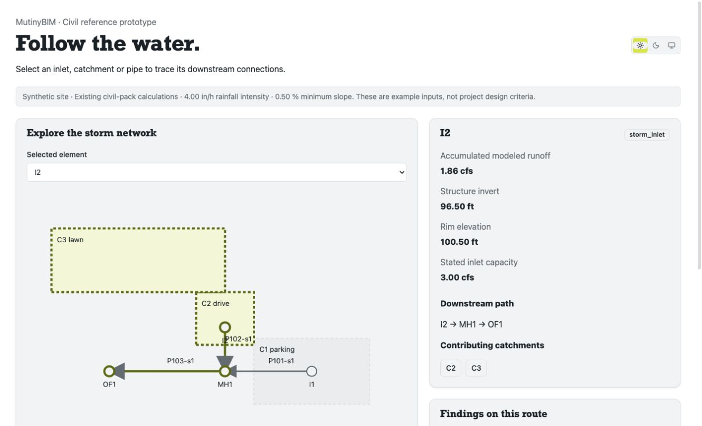

# Civil connection explorer: follow the water

A local, read-only product prototype: select a storm inlet, catchment or pipe,
follow its modeled downstream connections, and inspect the contributing
catchments, accumulated runoff and existing civil findings.

## Preview



Screenshot of the local synthetic-site prototype. Run it below to explore
the other elements and findings.

## Start

From the repository root, after installing its dependencies:

```sh
node tools/reference/civil-explorer/server.mjs
```

Open http://127.0.0.1:3197. Change the port with `CIVIL_EXPLORER_PORT`.
The server binds only to loopback. Stop it with Ctrl-C. No accounts, cloud
services, AI providers or database are needed. The build is generated under
the Git-ignored `mutinybim-examples/civil-explorer/dist` directory; restart to
rebuild after editing sources.

## Three-minute demonstration

1. Select **I1**: C1 contributes 2.64 cfs against a stated 2.50 cfs inlet
   capacity. Follow I1 → MH1 → OF1. The existing civil check reports the overload.
2. Select **I2**: C2 and C3 contribute 1.86 cfs. P102 was drawn MH1 → I2,
   but the oriented network correctly follows I2 → MH1. Drawing direction
   does not determine drainage direction.
3. Select **OF1**: all three catchments contribute approximately 4.50 cfs.
4. Select **P103-s1**: inspect its length, flow and structure-invert slope.
   The pack reports approximately 0.05% against a fixture minimum of 0.50%.
5. Select **C3**: inspect its area, coefficient source and explicit I2 assignment.
6. Switch light/dark using the shared theme toggle.

Buttons and the labeled select support keyboard selection. The site drawing
is a non-interactive schematic; the controls select and highlight elements.
Catchment-to-inlet assignments are shown in the inspector, not as invented
overland flow paths. Upstream contributing catchments are identified, while
highlighted pipes represent the downstream path from the selection.

## Implementation and boundaries

The model reuses the civil pack's existing
`packages/bim-pack-civil/__tests__/fixtures/synthetic-site.ts`, built through
kernel commands with the civil pack bound. This explorer reads that fixture;
it does not edit a person's model. All runoff, capacity, slope results and
engineering findings come from the existing civil pack. No formula, design
default, MCP tool, production package or add-on contract is changed.

`data.ts` adapts existing solver outputs into unit-labeled browser data and
traces the solver's oriented downstream graph with cycle/unresolved-path
guards. The UI uses `@permitzip/bim-ui` controls, provider and theme variables.
The local server reuses the editor's build tooling. This is a tiny-fixture
prototype; no 250k/1M performance claim is made.

Inputs are synthetic examples, not recommended design criteria. The pack
uses one design intensity and adds peaks without time of concentration.
Inlet capacity is supplied rather than calculated from grate geometry.
Structure inverts govern slope; full-flow Manning capacity is not HGL,
surcharge, tailwater or detention analysis. Terrain, capture, bypass and
overland routing are not evaluated. The UI states these limits and keeps
missing results unknown. Any later changes to engineering methods or design
defaults require licensed review under CONTRIBUTING.md.

## Verify

```sh
node --test tools/reference/civil-explorer/explorer.test.mjs
npx tsc -p tools/reference/civil-explorer/tsconfig.json
npx eslint tools/reference/civil-explorer
```

## Civil framing for the related ideas

| Idea | Civil demonstration |
| --- | --- |
| Connection explorer | Select an inlet and follow its catchments and downstream storm pipes to an outfall. |
| Design-change packet | Relocate an inlet or revise a pipe alignment; compare quantities and existing slope/runoff checks. |
| Review freshness | Revise an invert or contributing catchment after review; show what evidence needs another look. |
| Firm playbooks | A configurable synthetic storm-network setup with explicit project inputs and review steps. |
| Design decision record | Record why a catchment was assigned to an inlet and what assumptions need verification. |
| Public task benchmark | Test whether an assistant traces a reversed-drawn pipe correctly and reports missing rainfall data. |

The rooftop reference remains a separate earlier demonstration. Future team
proposals can use these civil workflows and clearly separate implemented
capabilities from suggestions. Discuss scope with maintainers before an
upstream feature issue or PR.
