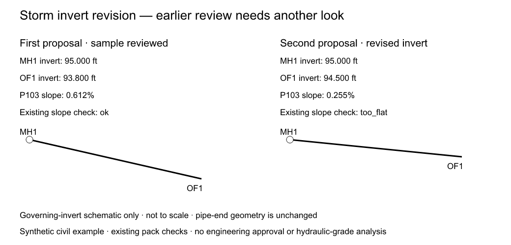

# Civil review packet: an outfall invert changes after review

A local civil counterpart to the rooftop review reference, using the same
synthetic drainage site as `../civil-explorer`. It demonstrates why a review
can need another look even when the pipe record itself is unchanged.

## Preview



Generated synthetic invert schematic, not a scaled construction profile.
Run the example below to reproduce the model snapshots and review packet.

## Run

From the repository root:

```sh
node tools/reference/civil-review/run.mjs
node --test tools/reference/civil-review/reference.test.mjs
npx tsc -p tools/reference/civil-review/tsconfig.json
npx eslint tools/reference/civil-review
```

Outputs go to `mutinybim-examples/civil-review/` (ignored by Git). Use
`--out <folder>` to choose another destination. Regeneration replaces files
with the same output names. Open `review-packet.md` and `since-review.png`.

## Reference story

- Accepted fixture: MH1 invert 95.00 ft, OF1 invert 94.90 ft. The existing
  P103-s1 slope check is below the fixture's 0.50% minimum.
- First branch proposal: lower OF1 to 93.80 ft. The check becomes `ok` at
  approximately 0.612%. Record a fictional civil review of this revision.
- Revised proposal: raise OF1 to 94.50 ft following a changed receiving-
  connection assumption. The slope drops to approximately 0.255% and the
  existing low-slope finding returns. The receiving connection is explanatory,
  not modeled or field verified.

Only the OF1 structure record changes. P103-s1's record, plan geometry,
diameter, routed length, catchments and runoff are unchanged. The civil pack
uses structure inverts for its slope calculation; this example changes that
governing metadata, not the physical pipe endpoints. The generated image is
an explanatory invert schematic, not a construction profile or a scaled drawing.

The packet compares both the full proposal and the changes since the first
review, pins snapshots with content hashes, shows the derived effect on P103,
and separates the newly returning slope finding from the inherited inlet
overload. All results come from the existing solver; no calculation method,
design default or production package is changed.

## Execution and review boundaries

The baseline reuses the civil proof pack's existing synthetic fixture built
through kernel commands. The two changes are scripts importing only the kit:
check → preview → apply on one real `InMemoryBranchHost` branch. The civil
pack is bound to the branch so the local runner resolves the correct add-on.
The runner asserts that preview saves nothing and Main remains unchanged.

The fictional review has an explicit whole-record dependency scope: OF1,
MH1, P103-s1 and the storm-system settings. A change to a covered record flags
it; unrelated records alone do not. This deliberately narrow scope cannot
establish that other engineering dependencies are unaffected. Review freshness
is an offline demonstration, separate from the production approval evaluator.
No licensed review, automatic notice, professional approval or merge occurs.

Inputs are synthetic and are not recommended design values. The pack's
existing Rational-method and Manning calculations have their documented
limits: one intensity, no time-of-concentration routing, and no HGL,
tailwater, cover, utility crossing or inlet-capture analysis. A full-flow
reference capacity does not establish hydraulic adequacy. Any future change
to engineering methods or design defaults requires licensed review.

## Outputs and implementation

- `baseline.model.json`, `reviewed.model.json`, `revised.model.json`: exact states.
- `host-snapshot.json`: restorable Main, registry and branch history.
- `review-packet.json`: comparisons, source fingerprints, fictional review,
  dependency scope and existing solver results.
- `review-packet.md`, `since-review.svg`, `since-review.png`: team demonstration.

The runner adapts the rooftop example's local MCP harness. It reuses the
rooftop packet's `digest` and `changedElements` utilities, and the civil
explorer's unit-labeled solver adapter. No new dependency or MCP tool is added.
Whole-snapshot comparisons target this tiny offline fixture, not a production
hot path. Regenerate evidence after edits; no live freshness monitoring is claimed.

Keep this local for team feedback before proposing upstream integration.
