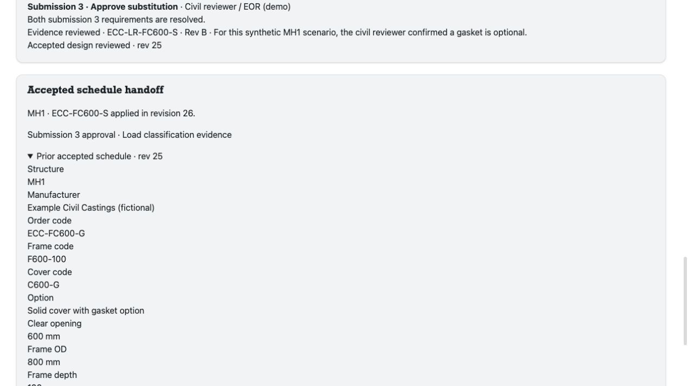

# MH1 frame-and-cover substitution



Run from the repository root.

```sh
node tools/reference/civil-substitution/server.mjs
```

Open http://127.0.0.1:3202. Set `CIVIL_SUBSTITUTION_PORT` to change the port.
Restart the process to reset the in-memory demo.

1. As Contractor, create a submittal and propose ECC-FC600-S.
2. Compare the accepted and proposed structure schedule rows. The order code,
   cover code and gasket option differ. Both source rows leave the rating unspecified.
3. Switch to Civil reviewer, choose Revise and resubmit or Reject substitution,
   enter a reason and record it.
4. After Revise and resubmit, switch to Contractor. Edit the gasket response and
   send submission 2 with the bundled synthetic load-rating document.
5. Switch to Civil reviewer. Compare the new evidence with submission 1 and
   assess each checklist item with a status and note, then record a decision
   for submission 2. Choose Revise and resubmit to continue the handoff scenario.
6. As Contractor, send submission 3. The bundled synthetic Rev B document states
   a fictional service load classification and the response confirms the gasket is optional.
7. As Civil reviewer, mark both submission 3 requirements Resolved with a note.
   Select Approve substitution and record the decision.
8. Preview the accepted schedule change, then apply ECC-FC600-S. The handoff
   links to the approval and load-classification document and shows the prior
   accepted schedule. Switch to Owner to see the same record read-only.

The server builds the accepted fixture with the catalog pilot in a temporary
directory. The substitution script replaces the isolated cover instance with
the solid variant at the same position and elevation. Each schedule column is
evaluated by the native schedule engine on its own model revision. The existing
lineage service records the decision against the proposal digest. The demo also
binds each decision to the submission number and a digest covering the model
delta, document contents and gasket response. This gives an evidence-only
resubmission its own review record. The accepted schedule continues to show ECC-FC600-G until the reviewer applies
the checked substitution script. Approval binds to the accepted design revision
as well as the submission. If the accepted design changes after approval, a
fresh review and preview are required. The regression test exercises this by
changing the accepted MH1 cover elevation between preview and apply.

Identities and product specifications are synthetic. The prototype runs on
loopback with in-memory review records and simulated role selection.

```sh
node --test tools/reference/civil-substitution/workflow.test.mjs
npx tsc -p tools/reference/civil-substitution/tsconfig.json
npx eslint tools/reference/civil-substitution tools/reference/civil-cover-catalog/run.mjs
```
