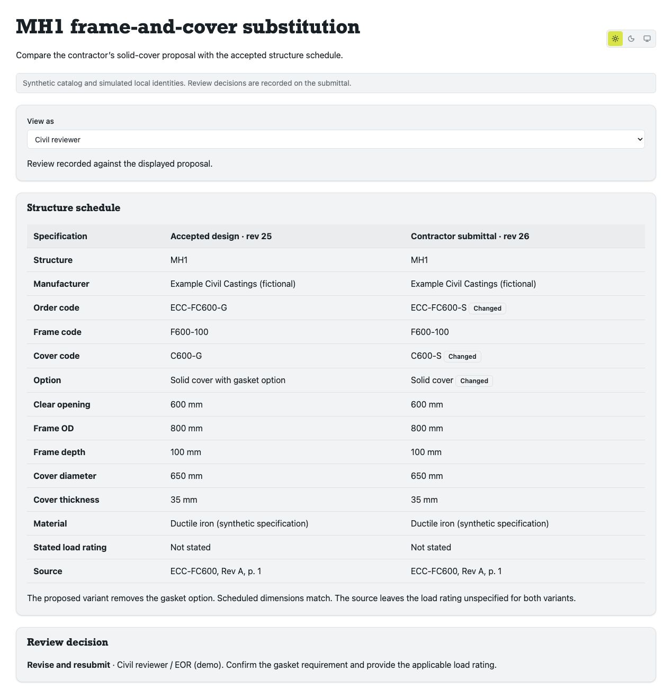

# MH1 frame-and-cover substitution



Run from the repository root.

```sh
node tools/reference/civil-substitution/server.mjs
```

Open http://127.0.0.1:3199. Set `CIVIL_SUBSTITUTION_PORT` to change the port.
Restart the process to reset the in-memory demo.

1. As Contractor, create a submittal and propose ECC-FC600-S.
2. Compare the accepted and proposed structure schedule rows. The order code,
   cover code and gasket option differ. Both source rows leave the rating unspecified.
3. Switch to Civil reviewer, choose Revise and resubmit or Reject substitution,
   enter a reason and record it. The Owner perspective shows the recorded decision.

The server builds the accepted fixture with the catalog pilot in a temporary
directory. The substitution script replaces the isolated cover instance with
the solid variant at the same position and elevation. Each schedule column is
evaluated by the native schedule engine on its own model revision. The existing
lineage service records the decision against the proposal digest. The accepted
schedule continues to show ECC-FC600-G.

Identities and product specifications are synthetic. The prototype runs on
loopback with in-memory review records and simulated role selection.

```sh
node --test tools/reference/civil-substitution/workflow.test.mjs
npx tsc -p tools/reference/civil-substitution/tsconfig.json
npx eslint tools/reference/civil-substitution tools/reference/civil-cover-catalog/run.mjs
```
