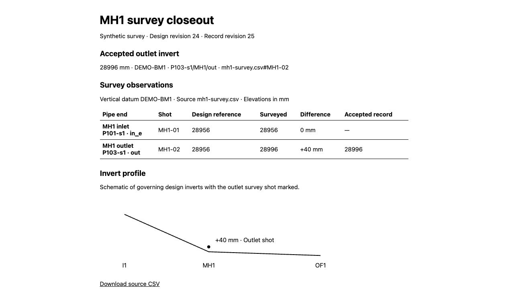

# MH1 survey review

[Sample closeout packet](sample/mh1-survey-closeout.zip)



From the repository root, run:

```sh
node tools/reference/civil-survey/server.mjs
```

Open http://127.0.0.1:3204. Import the bundled CSV, compare both shots, and
preview and accept the outlet invert into the record copy. Open the printable
closeout to print or save to PDF, or download the standalone HTML with its
embedded source CSV. The ZIP download includes the HTML and original CSV as
separate files and uses the local `zip` command. Its `manifest.json` records
the accepted invert entry and model revisions, plus SHA-256 checksums for both
files so recipients can check the extracted contents. Restarting the
server resets the in-memory demo.

The fixture uses metres on a synthetic local datum, DEMO-BM1. Import verifies
each shot against its pipe and MH1 connector, and refuses other units or datums.
The comparison uses the existing governing structure inverts as design references.
The profile is schematic. Acceptance uses a checked BIM script to store the
outlet elevation and its source as project metadata in a separate model copy.
It preserves the design revision and pipe geometry.

```sh
node --test tools/reference/civil-survey/workflow.test.mjs
npx tsc -p tools/reference/civil-survey/tsconfig.json
npx eslint tools/reference/civil-survey
```
