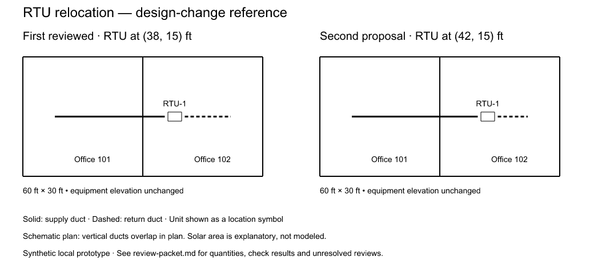

# Rooftop-unit design-change reference

A local discussion prototype for a design-change review packet. Synthetic
data only. It extends `packages/bim-script/examples/rooftop-unit.ts`; the two
rooms are named offices. The inherited 10-ton selection and 4000 CFM are
example inputs, not an office load calculation or recommended design.

## Preview



This checked-in image is generated from the synthetic scenario. Run the
commands below to regenerate the models, packets and comparisons locally.

## Run

From the repository root, with dependencies installed:

```sh
node tools/reference/rooftop-review/run.mjs
node --test tools/reference/rooftop-review/reference.test.mjs
npx tsc -p tools/reference/rooftop-review/tsconfig.json
```

Outputs go to `mutinybim-examples/rooftop-review/` (ignored by Git). Use
`--out <folder>` to choose another directory; files with the output names
below are replaced when you regenerate.

## Show the team

Start with `since-review.md` and `since-review.png` for the complete two-revision
story. The original first-proposal artifacts below are also preserved.

1. Open `comparison.png`: the same two-office building, before and after.
   RTU-1 moves from (30, 15) ft to (38, 15) ft. The solar request is explanatory;
   no solar geometry, roof construction or solar-clearance validation is modeled.
2. Open `review-packet.md`: the reason, exact revisions and fingerprints,
   changed elements, measured quantities, completed checks and unresolved reviews.
3. Point out the surprising result: supply segment centreline length grows
   8 ft, return shrinks 8 ft, so the aggregate supported quantity delta is zero.
   A net total alone would conceal meaningful routing changes. Centreline
   totals exclude fitting lengths; they are not fabrication takeoffs.
4. Show the unresolved structural, electrical, access and system-performance
   questions. This packet does not infer that the design is approved.

## Second proposal: what changed since review?

The runner records a fictional mechanical review against the first proposal
(model revision 2), then runs `relocate-again.ts` through the same preview,
check and apply tools on the same branch. RTU-1 moves another 4 ft east to
(42, 15) ft at revision 3; Main remains at revision 1.

Supply centreline grows another 4 ft (30.5 to 34.5 ft), and return shrinks
another 4 ft (14.5 to 10.5 ft). Aggregate quantity difference remains zero.
Seven covered equipment/routing records changed, so the sample review is
flagged `needs_another_look`, with the affected records listed.

New artifacts:

- `since-review.md`, `since-review.svg`, `since-review.png`: the walkthrough
  and printable comparison of the first and second proposals.
- `sample-review.json`: fictional reviewer, explicit scope and fingerprint
  of the first proposed snapshot. This is never a production approval.
- `review-freshness.json`: assessment of that sample record against revision 3.
- `since-review.json`: comparison and newly computed checks from revision 2 to 3.
- `review-packet-v2.md`, `review-packet-v2.json`: the full proposal from the
  accepted baseline (revision 1) to the second proposal (revision 3).
- `proposed-v2.model.json`, `host-snapshot-v2.json`: second proposed model and
  restorable branch history. Original snapshots stay available separately.

`review.mjs` conservatively compares whole records for equipment, equipment
types, runs, fittings and systems in this tiny fixture. Added and removed
covered records also flag the review. An unrelated wall edit or revision
increment alone does not. Such a wall edit could still matter to engineering:
this explicit scope does not infer indirect dependencies. It refuses a
mismatched reviewed snapshot, another branch, a backwards revision range or
an unsupported scope.

This is an offline review-freshness demonstration. It does not call or change
the production merge-approval evaluator, infer who must approve, send notices,
or automatically withdraw an approval. Existing merge approvals already use
content digests; integration with that workflow needs maintainer discussion.

## What actually runs

`baseline.ts` builds the example through the existing core MCP script tools.
The runner starts a real `InMemoryBranchHost` at that model revision and
creates a branch using its registry. `relocate.ts` previews and applies a
`move_elements` command on that branch through the same script tools. The
kernel carries the connected ducts; no model records are hand-edited.

The runner asserts that preview saves nothing and that Main is unchanged
after branch application. Script application is automatically approved only
inside this synthetic fixture, as in the existing example runner. There is
no professional sign-off, approval UI, merge or public service in this prototype.

`packet.mjs` uses the kernel's quantity delta and connector integrity APIs.
Its exhaustive near-element search and whole-snapshot comparisons are for
this tiny offline reference, not a proposed production hot path. No new
calculation method, MCP tool, dependency or kernel API is introduced.

Outputs:

- `baseline.model.json` and `proposed.model.json`: exact model snapshots.
- `host-snapshot.json`: Main, branch registry and changesets, restorable with
  `InMemoryBranchHost.start` (covered by the regression test).
- `review-packet.json`: machine-readable comparison and complete findings.
- `review-packet.md`: readable discussion packet.
- `comparison.svg` and `comparison.png`: printable black-and-white plan
  schematics. Equipment is a location symbol, not its exact footprint;
  vertical runs overlap in plan. These are generated illustrations, not editor screenshots.

Fingerprints pin the saved evidence, not a live revision. Rerunning creates a
new branch identity; equivalent geometry need not produce identical file
hashes. Regenerate the packet after changes.

## Next discussion with maintainers

- Where should a revision-pinned packet live in the existing review workflow?
- Which existing checks should run, and how should unavailable checks appear?
- How should per-system quantities complement the aggregate kernel delta?
- What evidence should become stale after a proposal changes?

Keep this local while discussing scope. Any upstream feature work should
start with an agreed issue and focused pull requests.
